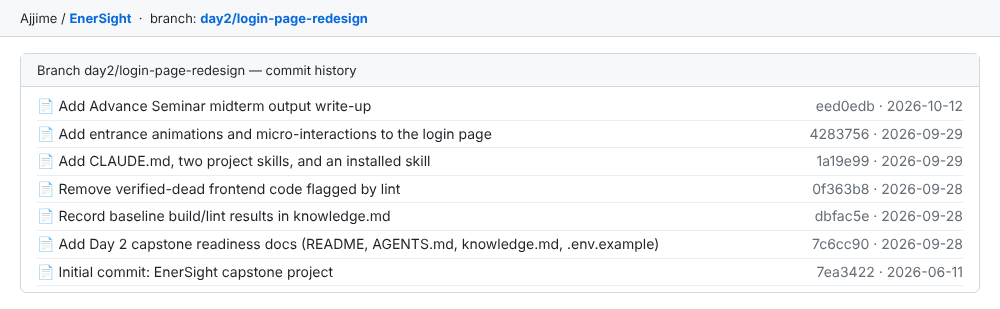
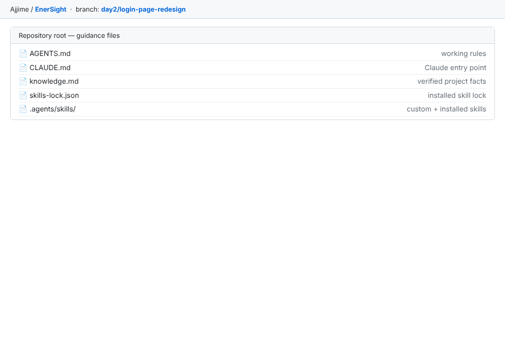
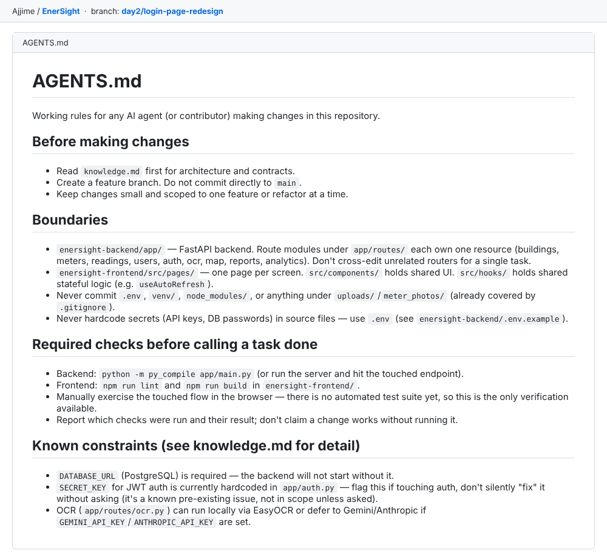
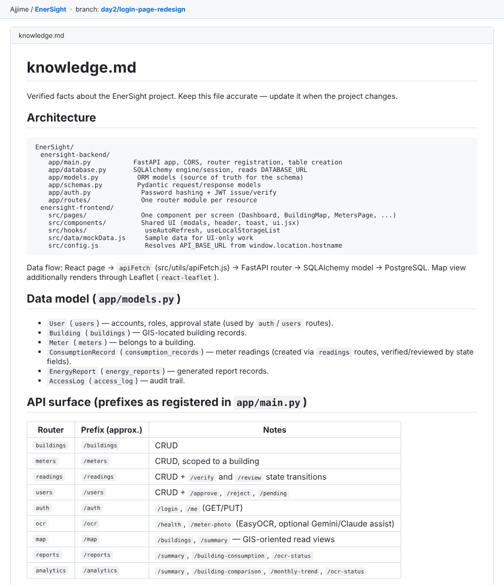
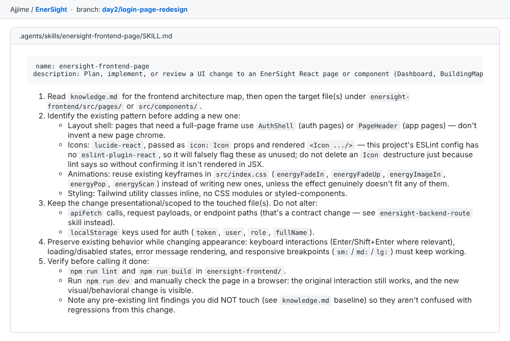
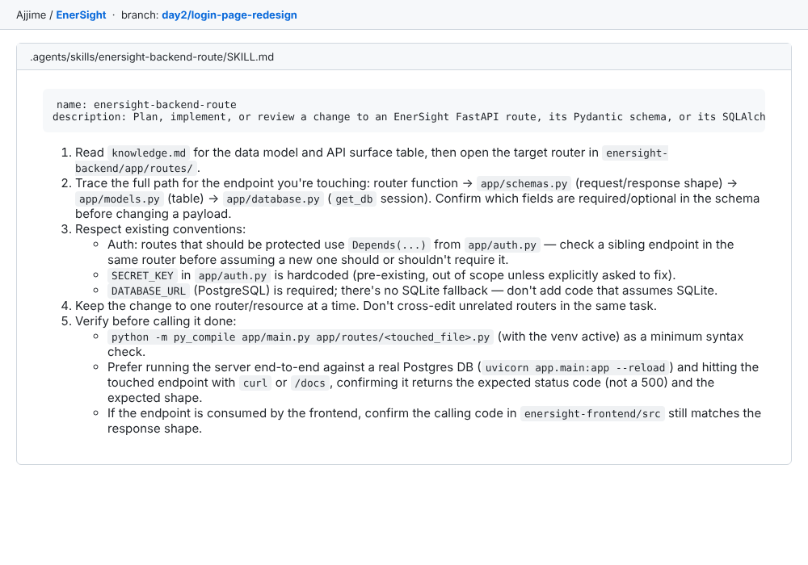
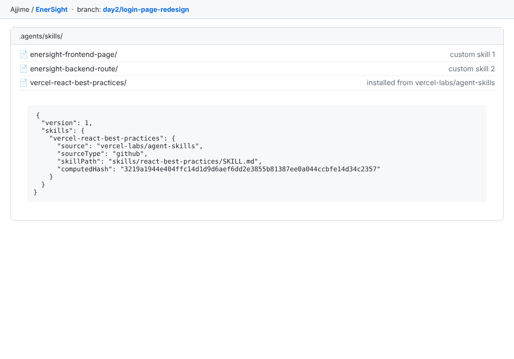
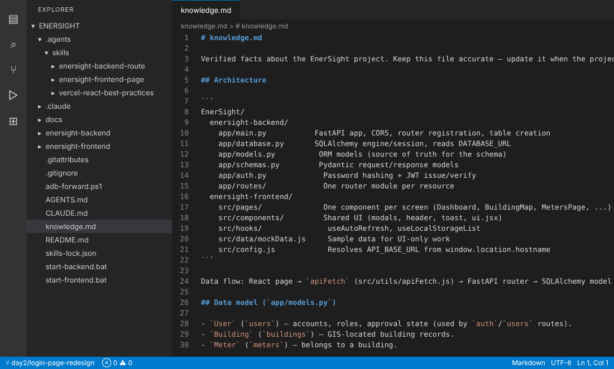

# Advance Seminar Series Midterm Output

**Members:**

Klarence A. De Gracia  
Syclops S. Lariosa  
Cyrel Jave M. Morales

## Overview

During our Advance Seminar activity, we worked on our EnerSight GitHub repository to practice using GitHub and AI-assisted development tools. EnerSight is a Building-Specific Energy Consumption Mapping and Optimization System using GIS, with a FastAPI + PostgreSQL backend, a React (Vite) + Tailwind + Leaflet frontend, and OCR-based meter reading. We followed the four required processes: creating a working branch, writing instructions for AI coding assistants, developing custom skills, and installing a skill from an available provider. Through these activities, we learned how to prepare a project repository so AI tools can support our software development workflow.

Repository: <https://github.com/Ajjime/EnerSight>

## Creating new branch

Our group created a new Git branch named `day2/login-page-redesign` in the EnerSight repository. We used it as the working branch for this activity so our changes stayed separate from `main`; `AGENTS.md` also forbids committing directly to `main`. The branch holds the guidance files and custom skills, plus one small, scoped feature the AI assistant implemented using them: the login page redesign with entrance animations and micro-interactions. Working on a branch kept each change small, reviewable, and easy to recover from.

*Figure 1. Commit history of the day2/login-page-redesign branch in the EnerSight repository.*

## Initialize/Create a knowledge.md/AGENTS.md/CLAUDE.md

Our group created three guidance files at the root of the EnerSight repository so AI coding assistants understand the project before changing code:

- **`AGENTS.md`** (working rules): what to read first, the rule to use a feature branch, folder boundaries (backend routers each own one resource; frontend pages vs. components vs. hooks), files that must never be committed (`.env`, `venv/`, `node_modules/`, uploads), the required checks before a task is done (`py_compile`, `npm run lint`, `npm run build`, manual browser check), and known constraints such as the hardcoded JWT `SECRET_KEY`.
- **`knowledge.md`** (verified facts): architecture map, data model (`User`, `Building`, `Meter`, `ConsumptionRecord`, `EnergyReport`, `AccessLog`), the API surface table, deliberate constraints, and a recorded lint/build baseline with the pre-existing lint findings explained.
- **`CLAUDE.md`** (Claude entry point): imports `AGENTS.md` and `knowledge.md`, lists the project skills and when to invoke them, and states that there is no automated test suite, so "verify" means running the checks and exercising the change manually.

Together these keep the AI tools within the existing project structure and avoid unnecessary modifications.

*Figure 2. Project guidance files in the repository root.*

*Figure 3. AGENTS.md containing the project's working rules.*

*Figure 4. knowledge.md containing the architecture and technical information (top section).*

## Create two (2) custom skills

We created two project-specific skills under `.agents/skills/`, each covering a different layer of the project.

### Skill 1: `enersight-frontend-page`

Guides AI assistants when planning, implementing, or reviewing a change to a React page or component. It tells the assistant to read `knowledge.md` first and reuse the existing layout shells (`AuthShell`, `PageHeader`), `lucide-react` icons, the keyframes in `src/index.css`, and inline Tailwind classes. It protects the `apiFetch` contract and the auth `localStorage` keys, warns that ESLint falsely flags `icon: Icon` props as unused, and requires `npm run lint`, `npm run build`, and a manual browser check.

### Skill 2: `enersight-backend-route`

Guides AI assistants when changing a FastAPI route, Pydantic schema, or SQLAlchemy model. It has the assistant trace router, `schemas.py`, `models.py`, and `database.py`, follow the `Depends(...)` auth convention, avoid SQLite assumptions (PostgreSQL only), edit one router at a time, and verify with `py_compile` and a real request to the touched endpoint.

*Figure 5. SKILL.md of the enersight-frontend-page custom skill.*

*Figure 6. SKILL.md of the enersight-backend-route custom skill.*

## Download/Install skills from skills provider

We installed the `vercel-react-best-practices` skill from the `vercel-labs/agent-skills` GitHub repository into `.agents/skills/vercel-react-best-practices/` (a `SKILL.md`, an `AGENTS.md`, and a `rules/` folder of individual React/performance rules). The install is recorded in `skills-lock.json` with its source and content hash so it can be reproduced. We use it as a reference for frontend work such as bundle size, re-renders, and data fetching, alongside our own skills and guidance files.

*Figure 7. Skills folder and skills-lock.json recording the installed skill.*

*Figure 8. Project guidance files and skills in Visual Studio Code (Explorer on the left, knowledge.md open).*

## Conclusion

Through the four processes of the Advance Seminar activity, our group practiced organizing a GitHub branch, preparing project guidance files, creating custom skills, and installing a skill from a provider. We learned that clear documentation and reusable guidelines help AI coding assistants follow a project's structure and rules, and that keeping each task to one small change on its own branch makes AI-assisted work easier to review and verify.
